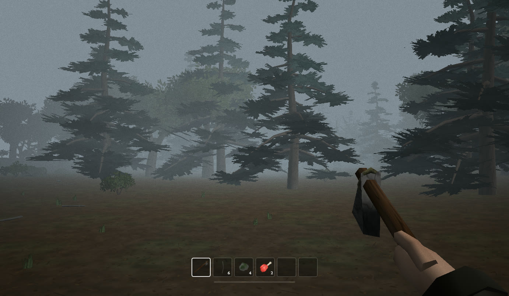
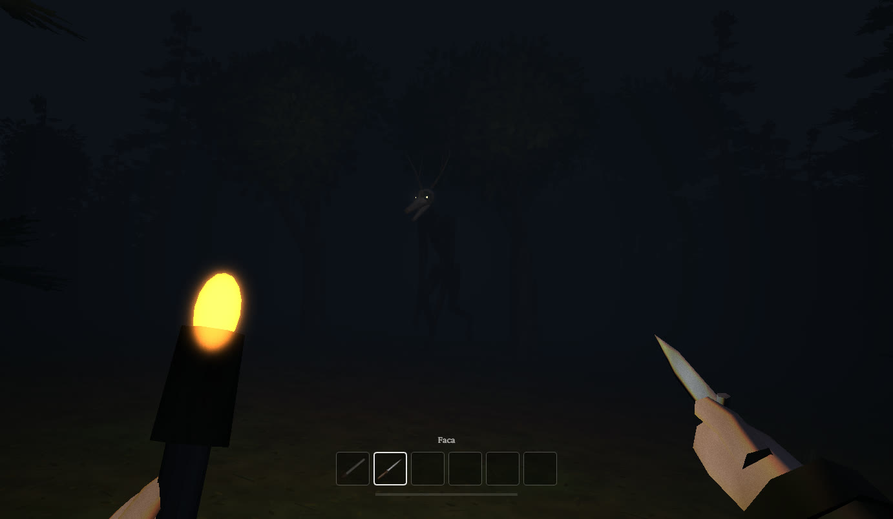

# Silent Hunt

Jogo de sobrevivência em primeira pessoa numa floresta infinita coberta de neblina, onde você caça para comer enquanto uma criatura caça você. **O silêncio é a sua melhor arma.**

Feito com [Babylon.js](https://www.babylonjs.com/) para um desafio com os temas **Sobrevivência**, **Floresta sombria** e **Furtividade e caça**. Todos os modelos 3D são gerados por código.

|                                                                                |                                                            |
| ------------------------------------------------------------------------------ | ---------------------------------------------------------- |
|                                |                   |
|  |  |

## Como rodar

Requisito: [Node.js](https://nodejs.org/) 24.

```bash
npm install
npm run build
npm run preview
```

Depois abra no navegador o endereço que aparecer no terminal (normalmente http://localhost:4173) e clique em **Novo mundo**. O jogo salva sozinho no navegador; ao voltar, **Continuar** retoma o mesmo mundo.

### Música

Todas as músicas vêm com o jogo (CC0 e CC-BY, creditadas no [CREDITS.md](CREDITS.md)): o tema do menu, as faixas do dia, os trechos do amanhecer e do entardecer, a da vitória e a da perseguição.

Para trocar a música da perseguição (opcional), coloque uma faixa na pasta `assets-private/music/chase/`; se houver mais de uma, vale a primeira em ordem alfabética.

### Para desenvolver

```bash
npm run dev
```

Em desenvolvimento há ferramentas extras: a galeria de modelos em `/?galeria`, o painel de teste na tecla F2, o tempo acelerado na T, os anéis de ruído na N, o Inspector do Babylon na F9 e os comandos `silentHunt.*` no console do navegador.

## Controles

| Ação                                                         | Tecla                                                               |
| ------------------------------------------------------------ | ------------------------------------------------------------------- |
| Andar                                                        | W A S D                                                             |
| Olhar                                                        | Mouse                                                               |
| Correr                                                       | Shift (segurar)                                                     |
| Agachar                                                      | C                                                                   |
| Pular                                                        | Espaço                                                              |
| Usar o item da mão (atacar, cortar, atirar, comer, colocar)  | Botão esquerdo                                                      |
| Mirar com o arco ou a espingarda                             | Botão direito (segurar)                                             |
| Interagir (pegar, limpar carcaça, acender, cozinhar, dormir) | E (algumas ações pedem para segurar)                                |
| Acender ou guardar a tocha                                   | F                                                                   |
| Arremessar uma pedra (segurar para mirar)                    | G                                                                   |
| Mapa                                                         | M                                                                   |
| Recarregar a espingarda                                      | R                                                                   |
| Escolher o item da mão                                       | 1 a 6 ou a roda do mouse                                            |
| Inventário e receitas                                        | Tab                                                                 |
| Modo de construção                                           | B (1 a 4 escolhem a peça, R gira, segurar o botão direito desmonta) |
| Pausa                                                        | Esc                                                                 |

## Como jogar

- **Saia da floresta.** Uma cabana perto do início tem um bilhete: siga os bilhetes, com a bússola no topo da tela, até as três peças de um rádio, monte-o no inventário e chame o resgate. Ele chega ao amanhecer, depois de uma última noite vermelha. Ou leia o diário do caçador e tente banir a criatura.
- **Você começa sem nada.** Junte galhos, pedras e fibra e faça a faca, o machado, o arco e a fogueira no inventário (Tab).
- **Faça silêncio.** Correr, pisar em galhos secos e atirar fazem barulho; andar agachado e no musgo, quase nenhum. A neblina esconde você tanto quanto esconde o resto.
- **A noite é da criatura.** De dia ela só observa de longe. À noite, ela espreita e ataca, e um golpe dela mata. Fogueiras acesas a mantêm longe; encará-la com a tocha acesa a segura na borda da luz, mas não a espanta. Agachado numa moita, com a tocha apagada, ninguém vê você, e uma pedra arremessada (G) a atrai para longe.
- **Coma.** Cace coelhos e cervos, limpe a carcaça e cozinhe a carne na fogueira. A gordura vira tochas.
- **Morrer custa caro.** Seus itens ficam numa mochila onde você caiu, e você renasce na última cama que colocou ou usou. Construa um abrigo antes que a noite chegue.

## Créditos

Os sons, a fonte e as tecnologias usadas estão em [`CREDITS.md`](CREDITS.md), e também na tela de créditos do jogo.

## Tecnologia e documentação

TypeScript, Vite, Babylon.js 9 e Havok. O design do jogo, as decisões e a arquitetura estão em [`docs/`](docs/README.md).

## Licença

O código está sob a licença [MIT](LICENSE). Os sons, a fonte e a música seguem as próprias licenças, listadas em [`CREDITS.md`](CREDITS.md).
